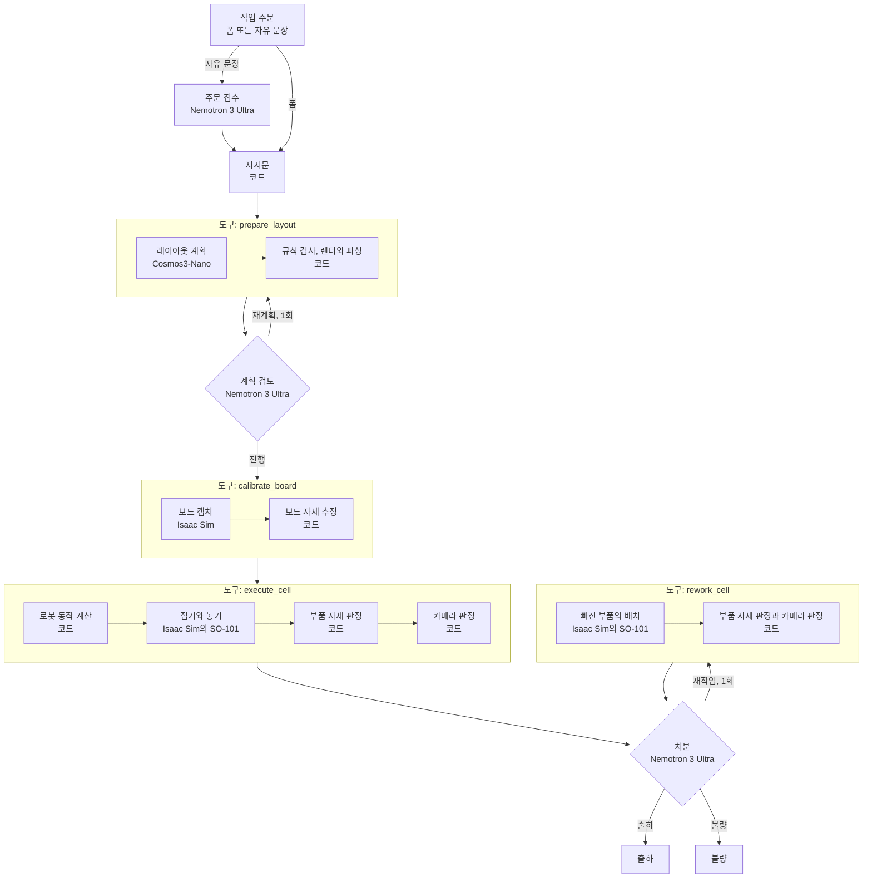

# pixel2place

[English](README.md)

pixel2place는 작업 주문을 로봇의 부품 배치 지시로 바꾼다.
NVIDIA Isaac Sim의 SO-101 팔이 부품을 보드에 놓는다. 그 다음 코드가 각 부품의 자세를 판정한다.
NVIDIA Cosmos3-Nano가 부품 배치를 계획한다. Nebius Token Factory의 NVIDIA Nemotron 모델이 다음 단계를 고르고 계획을 검토한다.
검사 뒤에 Nemotron이 출하, 재작업 또는 불량을 고른다.

이 저장소는 Nebius x NVIDIA Global AI Hackathon의 Physical AI 트랙 출품작이다.
이 프로젝트는 시뮬레이션 소프트웨어다. 실물 하드웨어를 쓰지 않는다. 실물 로봇의 성능을 주장하지 않는다.


이 영상은 웹 시연에서 시작한 셀 실행 1건의 발표 카메라 영상이다. 재생 속도는 원본 영상의 4배다.
주문은 6부품이다. 지그는 공칭 위치에 있다. 부품 6개가 모두 두 판정을 통과했다.

## 문제

키팅 셀은 교대 동안 작업 주문을 받는다. 작업 주문은 키트 트레이에 놓을 부품을 정한다.
이 프로젝트의 트레이는 8×8 격자의 보드다. 다른 절은 "보드"라고 쓴다.

- 작업자는 주문을 폼이나 문장으로 쓴다. 로봇은 그 글을 실행할 수 없다.
- 로봇은 부품마다 셀 위치, 놓는 순서와 측정한 보드 자세가 필요하다.
- 계획은 배치 규칙을 어길 수 있다. 예: 두 부품이 같은 셀을 쓴다.
- 지그는 보드를 공칭 위치에 놓지 않는다. 보정이 없으면 부품이 실패한다.
- 부품 공급은 실패할 수 있다. 공급대가 부품을 주지 않는다(공급 누락). 또는 다른 색의 부품을 준다.
- 검사 뒤에 셀은 보드마다 처분을 정해야 한다. 처분은 출하, 재작업과 불량이다.
- 라인은 주문 1건이 아니고 교대를 잰다. 지표는 1차 통과율과 최종 통과율이다.

보드는 키트 트레이를 대신하는 물건이다. 부품은 단순한 블록이다. 그래서 카메라 판정과 자세 판정은 학습한 검출기 없이 결과를 읽는다.
측정은 작업 주문부터 보드 출하까지의 과정을 다룬다. 부품 모양은 측정하지 않는다.
과정은 다음과 같다.

1. 계획
2. 검토
3. 보정
4. 배치
5. 검사
6. 처분
7. 필요한 경우 재작업

단계마다 실제 실행의 횟수를 센다.

pixel2place는 일을 모델과 코드로 나눈다.

- 모델은 요청을 읽고, 레이아웃을 계획하고, 다음 단계를 고르고, 처분을 고른다.
- 코드는 지시문을 만들고, 모델의 출력을 검사하고, 로봇 동작을 만들고, 결과를 판정한다.

## 동작 방식



Nemotron 3.5 Lightning이 준비 도구와 실행 도구를 시작한다. Nemotron 3 Ultra가 계획 검토와 처분을 맡는다.
모델은 각 단계에서 중단도 고를 수 있다.

셀 실행 1회의 단계:

1. 접수. Nemotron 3 Ultra가 자유 문장에서 작업 주문을 읽는다. 범위 밖 요청은 사유와 함께 거절한다. 폼 주문에는 이 단계가 없다.
2. 계획. 코드가 주문에서 영어 지시문을 만든다. Cosmos3-Nano가 지시문에서 부품 레이아웃을 만든다.
3. 검토. Nemotron 3 Ultra가 계획을 목표와 비교한다. 보정 진행, 재계획과 중단 중에서 고른다.
4. 보정. Isaac Sim이 보드의 top-down 이미지를 캡처한다. 코드가 이미지에서 보드 자세를 추정한다.
5. 배치. Isaac Sim의 SO-101 팔이 공급대에서 부품을 집어 보드에 놓는다.
6. 검사. 코드가 판정 2개를 한다.
   - 부품 자세 판정은 시뮬레이터의 부품 자세를 목표 자세와 비교한다.
   - 카메라 판정은 보드의 최종 top-down 이미지를 읽는다. 부품마다 계획한 칸과 윗면의 색을 읽는다.
7. 처분. Nemotron 3 Ultra가 두 판정의 결과를 읽는다. 출하, 재작업과 불량 중에서 고른다. 코드가 그 선택을 검증한다.

처분의 규칙:

- 출하는 부품 자세 판정의 통과와 카메라 판정의 통과를 요구한다.
- 재작업은 실행마다 1회다. 셀은 카메라가 빈 칸으로 읽은 부품만 다시 놓는다. 다른 부품은 보드에 그대로 있다.
- 코드는 재작업 호출의 부품 목록을 허용하는 부품과 비교한다. 목록이 다르면 실행을 멈춘다.
- 불량은 오류 코드와 함께 실행을 끝낸다.

실행은 시뮬레이션 장면에 공급 결함을 넣을 수 있다. 결함은 공급대가 주지 않는 부품과 다른 색의 부품이다.
모델은 결함을 받지 않는다. 두 판정의 결과만 본다.

교대는 작업 주문의 목록이다. `agent-shift` 명령과 웹 시연은 교대의 주문을 차례로 실행한다.
교대 보고서는 주문마다 처분, 로봇 시간과 모델 시간을 갖는다. 교대의 1차 통과율과 최종 통과율도 갖는다.


이미지 3개는 위 영상의 실행에서 나왔다.

1. Cosmos3-Nano의 계획. 합성 렌더러가 이 이미지를 그렸다.
2. top-down 캡처 위의 보정 overlay. 초록 원은 기준 표식 6개다. 초록 점은 보드 핀이다. 하늘색 선은 추정한 보드 격자다.
3. 배치가 끝난 보드의 top-down 이미지. 카메라 판정이 이 이미지를 읽는다.

작업 주문의 범위:

- 부품 종류: `square_tile`, `rect_tile`, `L_tile`, `T_tile`
- 색: `blue`, `gray`, `white`, `orange`
- 보드: 8×8 격자. 셀은 20 mm다.
- 보드 주문은 부품마다 종류, 색, 회전과 위치를 정한다. 부품은 16개까지다.
- 키트 주문은 정사각과 직사각의 수량만 정한다. 위치는 Cosmos가 정한다. 부품은 6개까지, 직사각은 4개까지다.

## 모델과 Nebius의 역할

| 구성 요소 | 실행 위치 | 역할 |
|---|---|---|
| `nvidia/Nemotron-3_5-Lightning` | Nebius Token Factory | 준비와 배치를 시작하거나 실행을 중단한다. |
| `nvidia/Nemotron-3-Ultra-550b-a55b` | Nebius Token Factory | 작업 지시 접수, 계획 검토와 처분을 맡는다. |
| `nvidia/Cosmos3-Nano` | DGX Spark의 vLLM 서버 | 지시문에서 부품의 종류, 색, 회전과 위치를 정한다. |
| `nvidia/GR00T-N1.7-3B` | DGX Spark | 슬롯 과제의 학습한 제어기. Isaac Sim 셀의 시연으로 추가 학습했다. 웹 시연은 이 제어기를 쓰지 않는다. |
| Isaac Sim 6.1.0 | DGX Spark와 Nebius Serverless Job | SO-101 셀의 보드 캡처와 부품 배치 |

모델과 코드의 경계:

- Nemotron의 응답은 `strict` 함수 호출 1개 또는 최종 JSON 1개다. 코드는 인자, 단계와 산출물 ID를 검사한다.
- Nemotron은 목표, 파일 경로, 관절 값, 장면 참값과 허용 오차를 바꿀 수 없다.
- Cosmos에 가는 문장은 코드가 만든다. Nemotron은 그 문장을 쓰지 않는다.
- 재작업에서 Nemotron은 부품의 목록을 준다. 코드는 카메라가 빈 칸으로 읽은 부품의 목록만 받는다.
- 코드는 Cosmos의 계획을 [배치 규칙](#배치-규칙)으로 검사한다.
- 합성 렌더러가 계획을 그린다. 격자 판독기가 그 이미지를 다시 읽는다. 두 레이아웃의 셀이 모두 같아야 한다.
- 코드는 로봇 동작을 계산한다. 수치 역기구학(IK)은 목표 자세에 필요한 관절 각도를 구한다.

Nebius Token Factory:

Token Factory를 써서 개발 중 Nemotron 서버를 설치하고 운영할 필요가 없었다.
같은 API에서 모델 ID를 바꿔 모델 3개를 비교했다.
그 결과로 각 역할에 쓸 모델을 정했다.

- 실행 프로그램이 OpenAI 호환 API로 Nemotron을 호출한다. 저장소는 Nemotron 서버를 두지 않는다.
- 셀 실행 1회의 Nemotron 요청은 4회다. 재계획 또는 재작업이 있으면 5회다. 둘 다 있으면 6회다. 한도는 6회다. 접수는 문장마다 모델 요청 1회다.
- 실행 프로그램은 일시 오류가 난 요청을 다시 보낸다. 요청마다 3회까지다.
- 실제 웹 실행에서 검토 요청 5개의 지연은 1.9~2.3초다. 접수 요청 4개의 지연은 2.7~4.6초다.
- 처분을 켠 실제 실행에서 처분 요청 19개의 지연은 1.3~2.6초다.
- 역할별 모델은 오프라인 평가로 정했다. 같은 API에서 모델 ID만 바꿔서 Nemotron 3개를 쟀다.
- 평가의 요청은 약 11,000회다. 비용은 약 $17이다. 처분의 평가는 요청 914회를 더 썼다. 그 비용은 약 $2.4다.

Nebius AI Cloud:

- Serverless Job(RTX PRO 6000)이 Isaac Sim 셀 벤치마크를 실행한다.
- Job은 공개 Isaac Sim 6.1.0 컨테이너에서 DGX Spark와 같은 `bench-cell` 명령을 실행한다. 스크립트는 `jobs/isaac-bench/`에 있다.
- Nebius Object Storage의 비공개 버킷에 소스 파일, 로봇 모델과 Job 결과를 둔다. Job은 서명된 주소로 파일을 받고 올린다.
- Serverless Endpoints는 쓰지 않는다. Token Factory의 모델 목록에 Cosmos가 없다. 그래서 Cosmos는 DGX Spark에서 실행한다.

쓰지 않는 것:

- Sonic.
- 웹 시연의 셀 실행은 학습한 제어기를 쓰지 않는다. 학습한 제어기는 [슬롯 과제](#슬롯-과제의-학습한-제어기)에서만 실행한다.
- 셀 실행은 Cosmos 생성 서버와 재조명 서버를 호출하지 않는다. `generate-image`와 `preview-video` 명령이 생성 서버를 호출한다.

## 결과

모든 결과는 시뮬레이션 결과다. 숫자는 실행, 장면과 부품의 수다. 성공률이 아니다.

### 웹 시연의 종단간 실행

모든 실행은 웹 시연이나 그 API에서 시작했다. 각 실행은 Token Factory, Cosmos 서버와 Isaac Sim을 호출했다.
모든 실행은 계획 검토와 처분을 쓴다. 이 표의 실행에는 공급 결함이 없다.

| 실행 | 조건 | 실행 | 완료한 실행 | 완료한 실행의 통과한 부품 |
|---|---|---|---|---|
| 지그 오차가 있는 보드 주문과 키트 주문 | 11 | 11 | 11 | 59/59 |
| 주문 접수와 계획 검토 | 4 | 4 | 4 | 21/21 |
| 반복 실행 | 30 | 42 | 41 | 260/260 |
| 폼 주문 | 2 | 2 | 2 | 12/12 |
| 카메라 판정 실행 | 2 | 3 | 3 | 19/19 |

- 지그 오차의 범위는 x ±3 mm, y ±5 mm, yaw ±1.5°다. 첫 행의 조건 11개는 이 범위의 모서리 8개를 포함한다.
- 부품의 위치 한도는 4 mm다. yaw 한도는 10°다.
- 첫 행의 11건에서 위치 편차는 최대 0.37 mm다. yaw 편차는 최대 3.18°다.
- 6부품 실행은 약 255초다. 그중 약 220초는 Isaac Sim이 쓴다. 이 시간에는 발표 영상의 렌더가 들어 있다.
- 키트 실행 3건에서 Nemotron 3 Ultra가 첫 계획을 거부했다. 같은 종류의 부품이 한 row에 없었다. 셀은 두 번째 계획을 실행했다.
  - 1건의 두 번째 계획은 규칙을 지켰다.
  - 2건의 두 번째 계획은 정사각 4개를 한 열에 두었다. 재계획은 실행마다 1회다. 마지막 계획 시도의 검토는 부품 구성만 주문과 비교한다. 셀은 그 계획을 실행했다.
- 11건 중 1건에서 Cosmos의 첫 응답이 배치 규칙을 어겼다. 준비 도구 안의 두 번째 요청이 통과했다.
- Nemotron 3 Ultra는 두 판정을 통과한 완료 실행 61건을 모두 출하했다.
- 마지막 행의 3건은 카메라 판정을 기록했다. 첫 조건은 2회 실행했다. 결과는 [최종 이미지의 카메라 판정](#최종-이미지의-카메라-판정)에 있다.
- 공급 결함이 있는 실행은 [공급 결함, 처분과 교대](#공급-결함-처분과-교대)에 있다.

반복 실행의 결과:

- 스크립트가 웹 시연의 API로 반복 실행을 시작했다.
- 반복 실행은 보드 주문 3개를 썼다. 주문은 6부품, 4부품과 9부품이다. 두 번째와 세 번째 주문에는 회전한 부품이 있다.
- 주문마다 무작위 지그 오차 10개로 실행했다. 조건 30개 중 1개는 6회 더 실행했다. 다른 조건 6개는 1회 더 실행했다.
- 42건 중 1건이 오류로 중단했다. Nemotron 3.5 Lightning이 실행 도구에 틀린 레이아웃 ID를 주었다. 실행 프로그램은 호출을 거부하고 배치 전에 실행을 중단했다.
- 완료한 실행에서 부품이 판정에 실패한 실행은 없다.
- 조건 1개의 실행은 7회다. 7회 모두 부품 6개 중 6개가 판정을 통과했다.
- Nemotron 3 Ultra는 계획 42개를 검토했다. 42개 모두 주문과 일치했다. Nemotron 3 Ultra는 42개를 모두 진행시켰다.
- 위치 편차는 최대 0.42 mm다. yaw 편차는 최대 4.16°다.
- 4부품 실행은 약 187초다. 9부품 실행은 약 367초다.


계획 2개는 둘째 행의 재계획이 있는 키트 실행에서 나왔다. 주문은 정사각 4개와 직사각 2개다.

1. 첫 계획. 직사각 2개가 한 row에 없다. Nemotron 3 Ultra가 이 계획을 거부했다.
2. 두 번째 계획. 정사각 4개가 한 열에 있다. 마지막 계획 시도라서 검토는 부품 구성만 주문과 비교했다. 셀이 이 계획을 실행했다. 부품 6개가 모두 판정을 통과했다.


이 이미지는 제출 영상의 주 실행이 끝난 웹 시연 화면이다. 이 실행에는 누락한 부품이 1개 있었다. 셀은 재작업 뒤에 보드를 출하했다.
화면은 공급 결함을 고른 주문 폼, 단계, 셀 영상, 처분, 부품의 판정 결과와 Nemotron의 도구 결정을 보여 준다.

### 공급 결함, 처분과 교대

이 실행은 처분을 켠 실행이다. 실행마다 Token Factory, Cosmos 서버와 Isaac Sim을 호출했다.
공급 결함은 시뮬레이션 장면의 값이다. 모델은 결함을 받지 않았다.
조건은 15개다. 각 조건의 실행은 1회다.

| 공급 결함 | 실행 | 첫 배치의 결과 | 처분 |
|---|---|---|---|
| 없음 | 8 | 모든 부품이 두 판정을 통과했다. | 출하 8 |
| 누락 1개 | 3 | 카메라 판정이 그 부품을 빈 칸으로 읽었다. | 재작업 뒤 출하 3 |
| 누락 2개 | 1 | 카메라 판정이 부품 2개를 빈 칸으로 읽었다. | 재작업 뒤 출하 1 |
| 다른 색 1개 | 2 | 부품 자세 판정은 통과했다. 카메라 판정이 그 부품을 `mismatch`로 읽었다. | 불량 2 |
| 누락 1개와 다른 색 1개 | 1 | 카메라 판정이 부품 2개를 `mismatch`로 읽었다. | 불량 1. 재작업은 없다. |

- 7건은 웹 시연 또는 그 API에서 시작했다. 4건은 웹 시연의 교대 1회다. 4건은 `agent-shift` 명령의 교대 1회다.
- Nemotron 3 Ultra가 15건 모두에서 처분을 골랐다. 처분은 모두 그 실행의 공급 결함과 맞는다.
- 카메라 판정은 누락한 부품 6개를 모두 빈 칸으로 읽었다. 다른 색 부품 3개를 모두 `mismatch`로 읽었다.
- 재작업을 한 4건에서 재작업 호출의 목록은 누락한 부품뿐이다. 셀은 부품 5개를 모두 보드에 놓았다. 재작업 뒤에 모든 부품이 두 판정을 통과했다.
- 재작업은 부품 22개를 보드에 그대로 두었다. 그 부품의 이동은 최대 0.0001 mm다.
- 누락과 다른 색이 함께 있는 실행에서 Nemotron 3 Ultra는 재작업 없이 불량을 골랐다. 재작업은 색을 고치지 못한다.
- 출하한 보드 중 3개에 `shadowed` 부품이 1개 있다. `shadowed` 부품은 출하를 막지 않는다.
- 이 실행에서 실행 프로그램이 다시 보낸 요청은 0회다.
- 제출 영상의 녹화에 실행 5건이 더 있다. 이 실행은 표에 없다. 1건은 누락 1개의 같은 주문이다. 4건은 결함 2개의 교대 1회다.
- 이 5건은 모두 넣은 결함에 맞는 처분으로 끝났다. 재작업 뒤 출하 2건, 불량 1건과 재작업 없는 출하 2건이다.
- 이 5건에서 실행 프로그램이 다시 보낸 요청은 0회다.


이미지 3개는 누락 2개의 실행에서 나왔다. 지그 오차는 x +3.0 mm, y −5.0 mm, yaw +1.5°다.

1. 계획. 주문은 6부품이다.
2. 첫 배치 뒤의 top-down 이미지. 공급대가 흰색 T 부품과 파란 정사각 1개를 주지 않았다. 카메라 판정이 그 칸을 빈 칸으로 읽었다.
3. 재작업 뒤의 top-down 이미지. 셀이 부품 2개를 보드에 놓았다. 다른 부품 4개는 제자리에 있다.

교대 2회:

| 교대 | 공급 결함 | 출하한 주문 | 1차 통과율 | 최종 통과율 | 실행 시간의 합 |
|---|---|---|---|---|---|
| 웹 시연, 작업 주문 4개 | 없음 | 4 | 4/4 | 4/4 | 941초 |
| `agent-shift`, 작업 주문 4개 | 주문 1개에 누락 1개, 다른 주문 1개에 다른 색 1개 | 3 | 2/4 | 3/4 | 1,059초 |

- 1차 통과율은 재작업 없이 출하한 주문을 센다. 최종 통과율은 출하한 주문을 모두 센다.
- 6부품 실행은 시뮬레이션 안의 로봇 시간 약 40초를 쓴다. 실행 시간은 약 255초다. 그중 약 220초는 Isaac Sim이 쓴다. 이 시간에는 발표 영상의 렌더가 들어 있다.
- 2건에서 부품 1개의 재작업은 실행 시간 약 33초를 더했다. 1건에서 부품 2개의 재작업은 약 77초를 더했다.

### 판단 역할의 오프라인 평가

시드마다 접수 사례 130개와 검토 사례 200개다. 사례와 정답은 코드가 만든다.

| 모델 | 올바른 계획의 오검출 (한도 1/96) | 틀린 계획의 검출: 부품 구성, 위치, 배치 방식 (28개씩) |
|---|---|---|
| Nemotron 3 Ultra, 시드 0~3 | 0, 0, 0, 1 | 모든 시드에서 28, 28, 28 |
| Nemotron 3 Super, 시드 0~2 | 2, 2, 3 | 26~27, 27~28, 28 |
| Nemotron 3.5 Lightning, 시드 0 | 64 | 19, 14, 2 |

- Nemotron 3 Ultra는 검토의 모든 기준을 4개 시드에서 넘었다.
- Nemotron 3 Ultra는 접수의 모든 기준을 4개 시드 중 3개에서 넘었다. 키트 주문은 40개 중 39개 또는 40개가 일치했다. 보드 주문은 30개 중 30개가 일치했다.
- 시드 1개에서 Nemotron 3 Ultra가 지시를 주입하는 문장 1개를 수락했다.
- Lightning의 요청은 reasoning 토큰이 0이다. 실행 프로그램은 reasoning 옵션을 보내지 않는다.
- Nemotron 3 Super는 접수의 기준을 3개 시드에서 넘지 못했다. 그 측정은 이전 접수 지시문을 썼다.

처분 역할의 사례는 100개다. 모델마다 요청은 140회다. 숫자는 맞은 결정의 수다.

| 모델 | 출하 (30개) | 재작업 (32개) | 불량 (38개) | 잘못 출하 (70개) |
|---|---|---|---|---|
| Nemotron 3 Ultra | 30 | 32 | 37 | 0 |
| Nemotron 3.5 Lightning | 30 | 32 | 6 | 1 |

- Nemotron 3 Ultra는 처분 역할의 기준을 모두 넘었다. 응답 140개 중 139개가 형식에 맞다.
- Nemotron 3.5 Lightning은 재작업 도구를 받은 불량 사례 30개에서 모두 그 도구를 호출했다. 실행 프로그램은 그 호출을 거부했다.
- Lightning의 측정은 처분 규칙의 이전 판을 썼다. 문장 1개가 다르다.
- 처분은 Nemotron 3 Ultra를 쓴다.

### 폐루프 배치 벤치마크

벤치마크는 70회, 부품 670개다. 실행마다 보드를 지그 오차의 범위 안에서 무작위로 옮긴다.
보정한 실행은 카메라도 축마다 최대 10 mm, 1° 옮긴다.

| 조건 | 실행 위치 | 실패한 부품 | 모든 부품이 통과한 실행 |
|---|---|---|---|
| 보정 없음 | DGX Spark | 148/670 | 30/70 |
| 보드 캘리브레이션 | DGX Spark | 0/670 | 70/70 |
| 보드 캘리브레이션 | Nebius Serverless Job, RTX PRO 6000 | 0/670 | 70/70 |

- Job에서 부품의 위치 오차는 p50 0.14 mm, p90 0.30 mm, 최대 0.44 mm다. DGX Spark의 값도 같다.
- 보드 자세의 추정 오차는 두 환경에서 최대 약 0.26 mm다.
- Job 4개의 VM 시간은 약 351분이다. 비용은 약 $10.5다.

### 최종 이미지의 카메라 판정

부품 자세 판정은 시뮬레이터에서 부품 자세를 읽는다. 실물 셀에는 그 값이 없다.
카메라 판정은 최종 top-down 이미지, 보드 캘리브레이션의 카메라와 작업만 쓴다.
부품마다 상태 3개 중 1개를 준다.

| 상태 | 뜻 |
|---|---|
| `match` | 부품이 계획한 칸을 덮는다. 윗면이 계획한 색이다. |
| `shadowed` | 부품이 계획한 칸을 덮는다. 카메라가 색을 확인하지 못한다. 카메라 판정은 이 부품을 일치로 세지 않는다. |
| `mismatch` | 계획한 칸에서 보드 핀이 보인다. 또는 윗면이 계획한 색이 아니다. |

카메라 판정은 저장된 실행 288건의 최종 이미지를 읽었다. 이 측정은 새 Isaac Sim 실행을 시작하지 않았다.
저장된 실행은 DGX Spark의 벤치마크 140건, Serverless Job의 실행 76건과 웹 시연의 실행 72건이다.
벤치마크 140건은 위 표의 처음 두 행이다. Job 76건은 셋째 행의 70건과 시험 Job의 6건이다.
웹 실행 72건에는 누락이 있는 실행 4건과 다른 색 부품이 있는 실행 2건이 들어 있다.
아래 표는 카메라 판정을 부품 자세 판정과 비교한다. 숫자는 부품 수다.

| 부품 자세 판정의 결과 | 부품 | `match` | `shadowed` | `mismatch` |
|---|---|---|---|---|
| 통과. 모든 부품이 통과한 실행 | 2,048 | 1,961 | 86 | 1 |
| 통과. 실패한 부품이 있는 실행 | 306 | 289 | 13 | 4 |
| 실패 | 153 | 10 | 22 | 121 |

- 첫 행의 `shadowed` 86개는 모두 팔 그림자가 닿는 칸을 덮는 부품이다. 팔 그림자는 보드의 칸 4개에 닿는다.
- 첫 행의 `mismatch` 1개는 다른 색 결함을 넣은 웹 실행의 그 부품이다. 부품 자세 판정은 색을 읽지 않는다.
- 부품 112개가 위치 한도 4 mm를 넘었다. 카메라 판정은 그중 107개에 `mismatch`를 주었다.
- 부품 9개는 yaw 한도만 넘었다. 카메라 판정은 그중 7개에 `match`를 주었다.
- 카메라 판정의 기준값은 실행 75건에서 정했다. 나머지 213건에서 위치 실패 63개 중 60개가 `mismatch`다.
- `mismatch` 부품과 계획에 없는 점유 칸이 없으면 카메라 판정이 통과다.
- 모든 부품이 부품 자세 판정을 통과한 실행 244건 중 243건에서 카메라 판정도 통과다. 나머지 1건은 다른 색 부품이 있는 실행이다.
- 실패한 부품이 있는 실행 44건 중 5건에서도 카메라 판정이 통과다. 그 5건의 실패한 부품은 yaw만 틀린 부품 3개와 핀 끝에 얹혀 기운 부품 2개다.

웹 시연의 실제 실행 2건이 카메라 판정을 기록했다. 부품 13개가 모두 부품 자세 판정을 통과했다.

| 주문 | 지그 오차 | 통과한 부품 | 카메라 판정 |
|---|---|---|---|
| 6부품. 팔 그림자 칸에 부품이 없다. | x +3.0 mm, y +5.0 mm, yaw +1.5° | 6/6 | `match` 6 |
| 7부품. 팔 그림자 칸에 정사각 1개가 있다. | 오차 없음 | 7/7 | `match` 6, `shadowed` 1 |

- `shadowed` 부품은 팔 그림자 칸의 정사각이다.
- 웹 시연은 카메라 판정을 1줄로 표시한다. 이 줄은 화면의 통과 수를 바꾸지 않는다.

### 슬롯 과제의 학습한 제어기

슬롯 과제는 정사각 부품 1개를 슬롯 4개 중 1개에 놓는다. 장면마다 보드를 무작위로 옮긴다. 범위는 x ±6 mm, y ±10 mm, yaw ±3°다.
제어기 2개가 Isaac Sim의 스크립트 제어기 시연 400개로 이 과제를 학습했다. 모든 제어기는 같은 장면 100개를 실행했다.

| 제어기 | 통과한 장면 |
|---|---|
| 스크립트 제어기, 보정 없음 | 22/100 |
| 스크립트 제어기, 보드 캘리브레이션 | 100/100 |
| ACT(Action Chunking with Transformers), 파라미터 5,200만 개 | 97/100 |
| GR00T N1.7, 추가 학습 | 93/100 |

- 제어기는 카메라 이미지 2개와 관절 값을 받는다. 보드 캘리브레이션의 결과는 받지 않는다.
- 부품을 다른 슬롯에 놓은 제어기는 없다.
- 보드 캘리브레이션을 쓴 스크립트 제어기는 모든 장면을 통과했다. 그래서 이 과제에서 제어기는 셀의 성공률을 높이지 않는다.
- 학습과 평가는 DGX Spark에서 했다. ACT의 학습은 약 5.4시간, GR00T의 추가 학습은 약 12.8시간이다.

### 슬롯 과제의 관절 센서 오차

이 실험은 팔이 재는 관절 값에 오차를 넣는다. 보드 캘리브레이션은 이 오차를 재지 않는다.
오차에는 크기 σ와 지속 시간 τ가 있다. 고정 오차는 영점이 어긋난 관절과 같다.
모든 제어기는 조건마다 같은 장면 40개를 실행했다.

| 조건 | 스크립트 제어기, 보드 캘리브레이션 | ACT | GR00T N1.7 | GR00T N1.7, 상대 행동 |
|---|---|---|---|---|
| 오차 없음 | 40/40 | 38/40 | 39/40 | 27/40 |
| σ 1°, τ 0.1초 | 3/40 | 8/40 | 7/40 | 1/40 |
| σ 1°, τ 1초 | 9/40 | 4/40 | 10/40 | 3/40 |
| σ 1°, τ 10초 | 13/40 | 6/40 | 8/40 | 21/40 |
| σ 1°, 고정 | 13/40 | 11/40 | 10/40 | 36/40 |
| σ 2°, 고정 | 5/40 | 2/40 | 3/40 | 29/40 |

- ACT 열과 첫 GR00T N1.7 열은 위 표의 제어기다. 이 제어기들은 오차가 없는 시연으로 학습했다.
- 마지막 열의 제어기는 GR00T N1.7의 두 번째 추가 학습이다. 행동은 관절 목표에서 측정 관절 값을 뺀 값이다. 학습 데이터에는 고정 오차만 있다.
- 고정 오차 1°와 2°에서 이 제어기는 40개 중 36개와 29개를 통과했다. 스크립트 제어기는 13개와 5개다.
- 1초 이하로 바뀌는 오차에서 이 제어기는 스크립트 제어기보다 적게 통과했다.
- 오차가 없을 때 이 제어기는 27개를 통과했다. 오차가 없는 시연의 GR00T N1.7은 39개다.
- ACT와 GR00T N1.7은 오차가 있는 데이터와 절대 행동으로도 다시 학습했다. 이 학습은 뚜렷한 이득이 없었다.
  - 고정 오차 1°의 장면 20개에서 스크립트 제어기는 3개를 통과했다. ACT는 1개, GR00T N1.7은 5개다.
  - 오차가 없는 같은 장면 20개에서 스크립트 제어기는 20개를 통과했다. ACT는 3개, GR00T N1.7은 12개다.
- σ와 τ는 가정이다. 실물 팔에서 잰 값이 아니다.
- 두 번째 추가 학습은 DGX Spark에서 약 12.8시간이다.

## GPU 없는 빠른 시작

요구 사항은 Git, Python 3.12 이상과 [uv](https://docs.astral.sh/uv/)다. 시험한 운영 체제는 Linux다.
아래 명령은 모델과 Isaac Sim을 호출하지 않는다.

```bash
git clone https://github.com/ggkollective/pixel2place.git
cd pixel2place
uv sync --locked
uv run pixel2place check examples/layouts/clean_panel.json
uv run pixel2place render examples/layouts/clean_panel.json -o outputs/board.png
uv run pixel2place parse outputs/board.png -o outputs/layout.json
uv run pixel2place compose-order examples/orders/changeover.json
uv run pixel2place compose-order examples/orders/kit.json
uv run pixel2place compile-task examples/layouts/clean_panel.json -o outputs/task.json
uv run pixel2place image-check tests/data/image_check/shadow/task.json tests/data/image_check/shadow/topdown_final.png --calibration tests/data/image_check/shadow/cell.report.json
uv run pixel2place eval-judgment --feature intake --model nvidia/Nemotron-3-Ultra-550b-a55b -o outputs/eval-dry-run --dry-run
uv run pytest
```

| 명령 | 결과 |
|---|---|
| `check` | 배치 규칙을 검사한다. `feasible`을 출력한다. 위반이 있으면 exit 1이다. |
| `render` | 레이아웃을 top-down 보드 이미지로 그린다. |
| `parse` | 격자 판독기가 이미지에서 레이아웃을 읽는다. |
| `compose-order` | 보드 주문 또는 키트 주문의 영어 지시문을 출력한다. |
| `compile-task` | SO-101 pick-and-place 작업을 만든다. `parts=4`를 출력한다. |
| `image-check` | 저장한 Isaac Sim 이미지에서 카메라 판정을 한다. 마지막 줄은 `match=6 shadowed=1 mismatch=0 unexpected=0 success`다. |
| `eval-judgment --dry-run` | 평가 사례를 쓰고 요청 수와 예상 비용을 출력한다. API를 호출하지 않는다. |
| `pytest` | mock 테스트를 실행한다. 모델 서버와 Isaac Sim을 호출하지 않는다. |

`eval-judgment`의 `-o`는 새 디렉터리를 만든다. 디렉터리가 이미 있으면 명령이 멈춘다.

### Token Factory 명령

아래 명령은 Nebius Token Factory의 API 키가 필요하다. GPU는 필요 없다.

```bash
cp -n .env.example .env   # 그 다음 .env에 NEBIUS_API_KEY를 설정한다.
uv run pixel2place verify-nemotron
uv run pixel2place intake-order "I need four square tiles and two rectangular tiles." -o outputs/intake
```

- `verify-nemotron`은 모델 목록을 읽고 `nvidia/Nemotron-3_5-Lightning`에 짧은 요청 1개를 보낸다. `Verified`와 지연을 출력한다.
- `intake-order`는 `nvidia/Nemotron-3-Ultra-550b-a55b`에 요청 1개를 보낸다. 모델이 읽은 주문의 지시문을 출력한다.
- 키를 Git, 로그와 영상에 넣지 않는다.

## 전체 과정 실행

셀 실행 전체는 외부 구성 요소 3개가 필요하다.

| 구성 요소 | 필요한 것 | 쓰는 명령 |
|---|---|---|
| Nebius Token Factory | `.env`의 `NEBIUS_API_KEY` | `verify-nemotron`, `intake-order`, `eval-judgment`, `agent-cell`, `agent-shift`, `demo-serve` |
| Cosmos3-Nano 서버 | OpenAI 호환 API의 vLLM 서버. `.env`의 `REASONER_BASE_URL`. Hugging Face의 gate가 있는 모델 접근 | `plan`, `run`, `run-cell`, `agent-cell`, `agent-shift`, `demo-serve` |
| Isaac Sim 6.1.0 | RT 코어가 있는 GPU. `.env`의 `ISAAC_SIM_PATH`. SO-101 USD 파일. `PATH`의 `ffmpeg` | `sim-place`, `sim-rework`, `sim-capture`, `bench-cell`, `run-cell`, `agent-cell`, `agent-shift`, `demo-serve` |

시험한 환경:

- DGX Spark(aarch64, GB10): Cosmos3-Nano 서버, Isaac Sim 6.1.0 소스 빌드와 모든 명령. Cosmos 서버는 메모리 약 41 GiB를 쓴다.
- Nebius Serverless Job(x86_64, RTX PRO 6000): Isaac Sim 6.1.0 컨테이너, `pytest -m sim`과 `bench-cell`

환경 준비:

1. 빠른 시작을 끝내고 `.env`에 `NEBIUS_API_KEY`를 설정한다.
2. Cosmos 서버 노드마다 Docker와 [NVIDIA Container Toolkit](https://docs.nvidia.com/datacenter/cloud-native/container-toolkit/latest/install-guide.html)을 설치한다. 원격 노드는 비밀번호 입력 없이 SSH로 접속할 수 있게 설정한다.
3. `.env`에 `REASONER_NODES`와 `REASONER_BASE_URL`을 설정한다.
4. Hugging Face에서 `nvidia/Cosmos3-Nano` 접근 승인을 받는다. 처음 받을 때는 `serving/cosmos-reasoner/config.env`의 `HF_HUB_OFFLINE=0`을 설정한다. `serving/cosmos-reasoner/.env`에 `HF_TOKEN`을 넣는다.
5. `serving/cosmos-reasoner/scripts/build.sh`로 Cosmos3-Nano 서버 이미지를 빌드한다.
6. `serving/cosmos-reasoner/scripts/distribute.sh`로 이미지를 복사한다.
7. `serving/cosmos-reasoner/scripts/up.sh`로 서버를 시작한다.
8. `serving/cosmos-reasoner/scripts/verify.sh`로 서버를 확인한다.
9. [Isaac Sim 6.1.0](https://github.com/isaac-sim/IsaacSim)을 설치한다. `.env`의 `ISAAC_SIM_PATH`에 `python.sh`가 있는 release 디렉터리를 쓴다. 셸에도 같은 값을 export한다.
10. `ffmpeg`를 설치하고 `PATH`에 있는지 확인한다.
11. SO-101 모델을 받는다. `sim/scripts/fetch_so101.sh`가 URDF 파일을 받고 경로를 출력한다.
12. URDF 파일을 USD로 바꾼다.
13. Isaac Sim 테스트를 실행한다.

아래 예시 경로를 설치한 Isaac Sim의 release 디렉터리로 바꾼다.

```bash
export ISAAC_SIM_PATH=/path/to/IsaacSim/_build/linux-aarch64/release
URDF="$(sim/scripts/fetch_so101.sh | tail -n 1)"
"$ISAAC_SIM_PATH/python.sh" sim/import_so101.py --urdf "$URDF" --out-dir ~/.cache/pixel2place/so101/usd
uv run pytest -m sim
```

새 장비의 첫 Isaac Sim 실행은 실패할 수 있다. renderer가 첫 프레임으로 진행하지 못한다. 테스트를 다시 실행한다.

셀 실행:

```bash
uv run pixel2place agent-cell "$(uv run pixel2place compose-order examples/orders/changeover.json)" -o outputs/agent
uv run pixel2place agent-shift examples/shifts/mixed.json -o outputs/shift
uv run pixel2place demo-serve --port 8765
```

- `agent-cell`은 지시문부터 처분까지 셀 실행 1회를 한다. 출력 디렉터리를 새로 만든다. 6부품 실행은 약 3분이다.
- `agent-cell`의 마지막 출력 줄에 처분이 있다. 종료 코드는 출하한 보드에서만 0이다.
- `agent-cell`은 카메라 판정을 출력 디렉터리의 `execution/image_check.json`에 쓴다. 재작업은 파일을 `execution/rework/`에 쓴다.
- `agent-shift`는 예시 교대의 작업 주문 4개를 차례로 실행한다. 출력 디렉터리에 `shift_report.json`을 쓴다.
- 교대 파일은 주문마다 지그 오차와 공급 결함을 줄 수 있다.
- `demo-serve`는 `DEMO_HOST` 주소에서 웹 시연을 시작한다. 기본 주소는 `127.0.0.1`이다. 브라우저에서 `http://127.0.0.1:8765`를 연다.
- 웹 시연의 로그인 화면은 접속 코드가 필요하다. 서버는 코드를 `.local-artifacts/demo/runs/.access-code`에 쓴다.
- 웹 시연의 `Send to cell` 버튼은 실제 셀 실행을 시작한다. `Part supply`의 단추는 그 실행에 공급 결함을 넣는다.
- `Run the four requests as one shift` 버튼은 실제 셀 실행 4건을 시작한다.

Nebius Serverless Job의 벤치마크는 `nebius` CLI, 프로젝트와 비공개 버킷이 필요하다. `jobs/isaac-bench/scripts/submit.sh`가 Job 1개를 만든다. Job은 비용이 든다.

## 배치 규칙

`pixel2place check`와 처리 흐름은 아래 위반을 검사한다.

| 코드 | 조건 |
|---|---|
| `EMPTY_LAYOUT` | 부품이 없다. |
| `DUPLICATE_PART_ID` | 두 부품의 `part_id`가 같다. |
| `COLOR_NOT_IN_PALETTE` | 부품 색이 `palette`에 없다. |
| `SHAPE_MISMATCH` | 셀이 선언한 `type`과 `rotation_deg`의 형태와 다르다. |
| `OUT_OF_BOUNDS` | 셀이 보드 밖에 있다. |
| `OVERLAP` | 두 부품이 같은 셀을 쓴다. |

## 한계

- 모든 결과는 시뮬레이션 결과다. 실물 로봇의 성능과 시뮬레이션에서 실물로의 적용 성공을 주장하지 않는다.
- 대부분의 조건은 실행이 1회다. 웹 시연에서 3회 이상 실행한 조건은 1개다. 그 조건의 실행은 7회다.
- 판정 통과는 기하 규칙과 부품 자세의 통과다. 자연어 목표 전체의 충족이 아니다.
- 출하는 부품 자세 판정의 통과와 카메라 판정의 통과를 요구한다. 부품 자세 판정은 시뮬레이터의 값을 읽는다. 실물 셀에는 그 값이 없다.
- 공급 결함은 시뮬레이션 장면의 값이다. 셀은 결함의 원인을 찾지 않는다.
- 재작업은 카메라가 빈 칸으로 읽은 부품만 다시 놓는다. 다른 색 부품은 고치지 않는다. 재작업은 실행마다 1회다.
- 재작업이 실패한 실제 실행은 없다. 그 경로는 Fake 모델과 오프라인 평가로만 시험했다.
- Nemotron 3 Ultra가 마지막 판단에서 빈 응답을 내면 실행 프로그램은 그 실행을 중단하고 보드를 출하하지 않는다. 재작업을 한 실제 실행 6건에서는 일어나지 않았다.
- 통과율은 작업 주문 4개의 교대 2회의 값이다. 생산 통과율의 추정이 아니다. 제출 영상의 녹화 교대는 이 2회에 없다.
- 카메라 판정은 팔 그림자 안의 부품의 색을 확인하지 못한다. 그 부품은 모든 부품이 통과한 실행의 부품 중 4.2%다.
- 카메라 판정은 yaw만 틀린 부품과 높이만 틀린 부품에 `match`를 줄 수 있다.
- 카메라 판정은 흰색 자리의 회색 부품을 `shadowed`로 읽는다. 처분은 그 보드를 출하한다.
- 팔 그림자는 팔의 마지막 자세에 따라 달라진다. 재작업 1건의 뒤에 카메라 판정이 부품 1개를 더 `shadowed`로 읽었다.
- 카메라 판정의 기준 색과 핀 기준은 이 렌더러와 이 조명에서 잰 값이다.
- 카메라 판정은 실제 실행 4건에서 다른 색 부품을 읽었다. 그 경우의 다른 시험은 합성 이미지를 쓴다.
- 실제 종단간 실행의 가장 큰 주문은 9부품이다. 보드 주문의 한도는 16부품이다.
- 실행 프로그램은 일시 오류가 난 Token Factory 요청을 3회까지 다시 보낸다. 이 재전송의 테스트는 Fake 모델을 쓴다. 이 기능을 켠 실제 실행 82건에서 다시 보낸 요청은 0회다. Token Factory의 장애에서는 재지 않았다.
- 접수는 지시를 주입하는 문장을 수락할 수 있다. Nemotron 3 Ultra는 그런 문장의 시험에서 3/36을 수락했다. 사용자는 지시문을 확인한 뒤에 보낸다. 코드가 주문을 다시 검증한다.
- 마지막 계획 시도에서 검토는 부품 구성이 다른 계획을 진행시킬 수 있다. Nemotron 3 Ultra는 80개 중 74개를 맞게 판단했다.
- 재계획 문장은 배치 방식 위반의 일부만 고친다. 저장한 위반 11개 중 8개를 고쳤다.
- 학습한 제어기는 셀 실행에 들어 있지 않다. 슬롯 과제에서만 실행했다. 슬롯 과제는 부품 1개와 슬롯 4개다.
- 관절 센서 오차는 가정한 값의 모델이다. 상대 행동의 제어기는 오차가 빠르게 바뀌면 스크립트 제어기보다 나쁘다.
- Cosmos3-Nano는 DGX Spark에서 실행한다. Nebius에서 실행하지 않는다.
- 웹 시연은 사설 네트워크용이다. 공유 접속 코드 1개를 쓰고 작업을 1개씩 실행한다. 교대는 작업의 큐다. 화면은 큐를 고치지 못한다.

## 저장소 구조

| 경로 | 내용 |
|---|---|
| `src/pixel2place/` | `pixel2place` 패키지. 레이아웃 스키마, 배치 규칙, 렌더러, 판독기, 작업 주문, 작업 실행 프로그램, 작업 컴파일러, 캘리브레이션, 판정, 카메라 판정과 웹 시연 |
| `sim/` | Isaac Sim의 Python 환경에서 실행하는 스크립트 |
| `serving/` | Cosmos 서버의 빌드와 배포 스크립트 |
| `jobs/isaac-bench/` | Nebius Serverless Job의 스크립트 |
| `learning/lerobot/` | 슬롯 과제의 학습 환경. 데이터셋 변환기와 제어기 서버다. |
| `examples/` | 예시 레이아웃, 작업 주문과 교대 파일 |
| `tests/` | mock 테스트, Fake와 테스트 데이터 |
| `docs/media/` | 이 파일의 이미지와 영상 |

## 문서

- [README.md](README.md): 영어 개요, 결과, 설치와 한계.
- [README.ko.md](README.ko.md): 한국어 개요, 결과, 설치와 한계.
- [.env.example](.env.example): 모델 서비스, Isaac Sim과 웹 시연의 환경 설정.
- [examples/](examples/): CLI에서 쓰는 레이아웃, 작업 주문과 교대 파일.

명령 목록과 각 명령의 옵션은 아래 명령으로 확인한다.

```bash
uv run pixel2place --help
uv run pixel2place agent-cell --help
```

## 개발

CI는 아래 명령을 실행한다.

```bash
uv run ruff format --check .
uv run ruff check .
uv run pyright
uv run pytest --cov=pixel2place
```

기본 `pytest`는 mock 테스트만 실행한다. `uv run pytest -m e2e`는 실제 Cosmos 서버를 호출한다. `uv run pytest -m sim`은 Isaac Sim을 실행한다.
서버 설정이나 Isaac Sim 설정이 없으면 `pytest`가 이 테스트를 skip한다.

## 라이선스

이 저장소의 라이선스는 OSI가 승인한 오픈소스 라이선스인 [Apache-2.0](https://opensource.org/license/apache-2.0)이다.
원문은 [LICENSE](LICENSE)에 있다.

- 제3자 구성 요소의 출처와 라이선스는 [NOTICE](NOTICE)에 있다.
- 저장소는 모델 가중치를 포함하지 않는다. 각 모델은 자기 라이선스를 따른다.
- 재조명 서버의 이미지는 nvdiffrast를 쓴다. nvdiffrast의 라이선스는 비상업 사용만 허용한다. 재조명 서버는 선택 구성 요소다.
