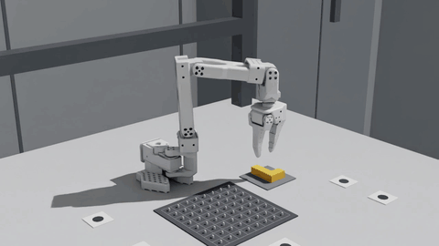
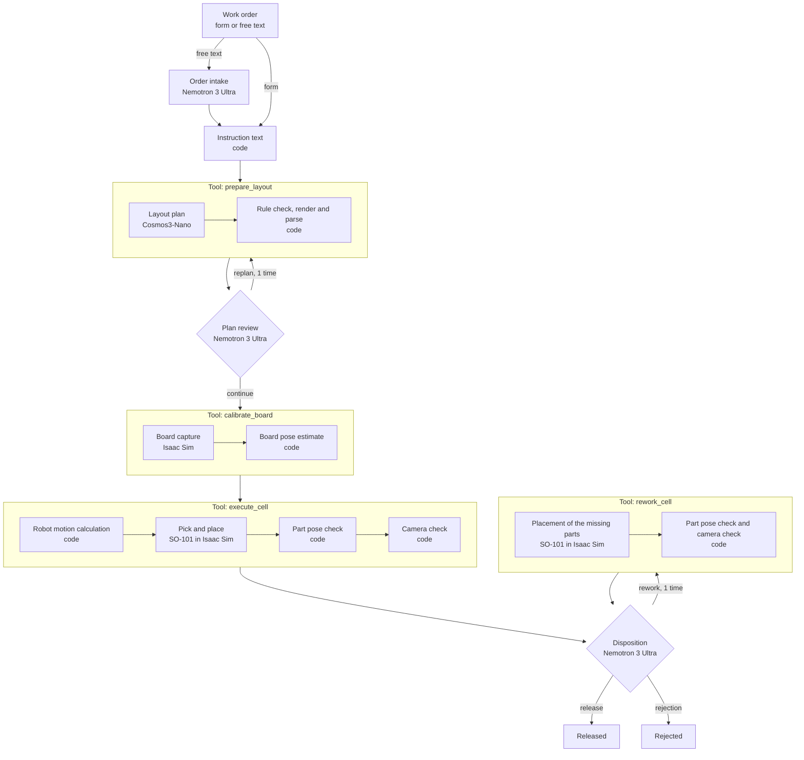
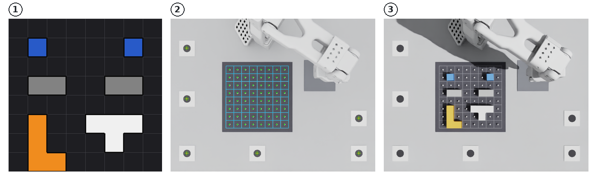
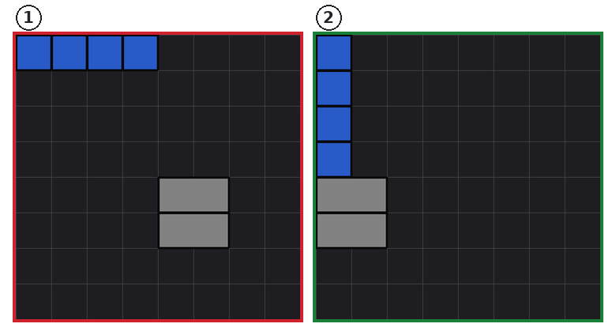
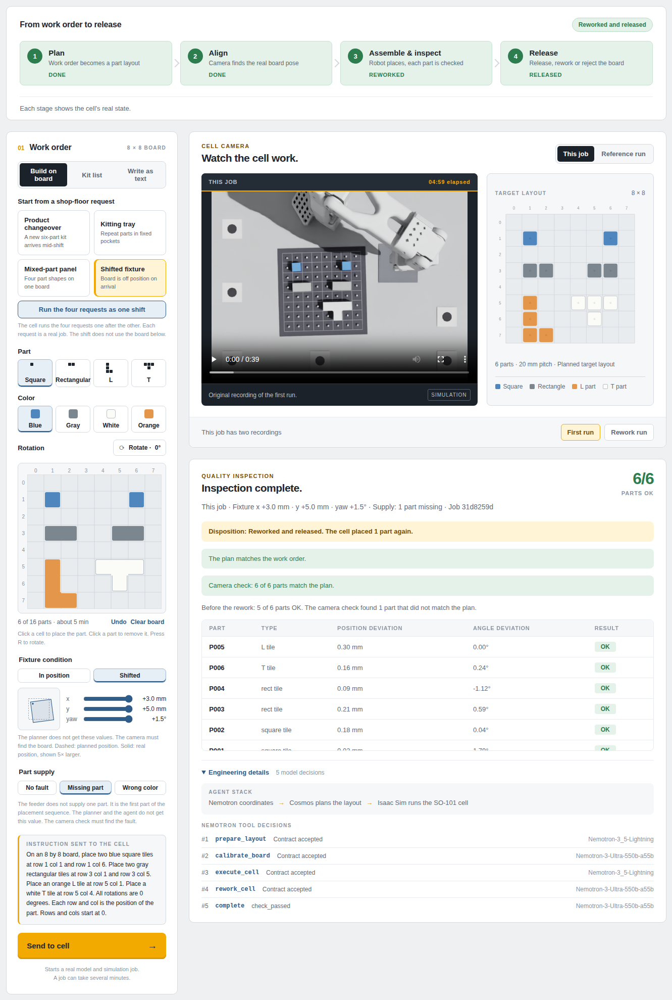
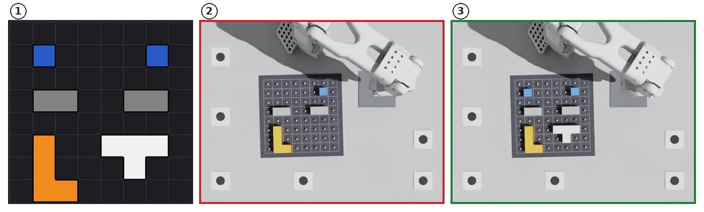

# pixel2place

[한국어](README.ko.md)

pixel2place turns a work order into instructions for a robot to place parts.
An SO-101 arm in NVIDIA Isaac Sim puts the parts on a board. The code then checks the pose of each part.
NVIDIA Cosmos3-Nano plans the part layout. NVIDIA Nemotron models on Nebius Token Factory select each step and review the plan.
After inspection, Nemotron selects release, rework or rejection.

This repository is a submission to the Nebius x NVIDIA Global AI Hackathon, Physical AI track.
The project is simulation software. It does not use physical hardware. It makes no claim about the performance of a real robot.



This recording is the presentation camera video of one cell run that started from the web demo. The playback speed is 4 times the speed of the original video.
The order has 6 parts. The fixture is at the nominal position. All 6 parts passed the two checks.

## Problem

A kitting cell gets work orders during a shift. A work order tells the cell which parts go on a kit tray.
In this project, the tray is a board with 8 by 8 cells. The other sections use the word "board".

- An operator writes the work order in a form or as a sentence. A robot cannot execute that text.
- The robot needs a cell position for each part, a placement sequence and the measured pose of the board.
- The plan can break placement rules. For example, two parts use the same cell.
- A fixture does not put the board at the nominal position. Without a correction, parts fail.
- The part supply can fail. The feeder can supply no part, or it can supply a part with the wrong color.
- After the inspection, the cell must give a disposition to each board: release, rework or rejection.
- A line measures a shift, not one work order. The measures are the first-pass yield and the final yield.

The board represents a kit tray. The parts are simple blocks. The camera check and the pose check can read the result without a trained detector.
The measurements cover the steps from a work order to a released board. They do not measure part shape.
The steps are:

1. Planning
2. Review
3. Calibration
4. Placement
5. Inspection
6. Disposition
7. Rework, if needed
 Each step has a count of real runs.

pixel2place divides the work between models and code:

- The models read the request, plan the layout, select the next step and select the disposition.
- The code makes the instruction text, checks each model output, makes the robot motion and checks the result.

## How it works



Nemotron 3.5 Lightning starts the prepare tool and the execute tool. Nemotron 3 Ultra does the plan review and the disposition.
At each step, a model can also stop the run.

One cell run has these steps:

1. Intake. Nemotron 3 Ultra reads a work order from free text. It rejects a request that is out of scope and gives a reason. A form order does not use this step.
2. Plan. The code writes an English instruction from the order. Cosmos3-Nano makes a part layout from the instruction.
3. Review. Nemotron 3 Ultra compares the plan with the goal. It selects one of three actions: continue to calibration, replan or abort.
4. Calibration. Isaac Sim captures a top-down image of the board. The code estimates the board pose from the image.
5. Placement. The SO-101 arm in Isaac Sim picks each part from a feeder and puts it on the board.
6. Inspection. The code does two checks.
   - The part pose check compares the pose of each part in the simulator with the target pose.
   - The camera check reads the final top-down image of the board. For each part, it reads the planned cells and the color of the top surface.
7. Disposition (release, rework or rejection). Nemotron 3 Ultra reads the results of the two checks. It selects release, rework or rejection. The code checks the selection.

The rules of the disposition:

- A release needs a pass of the part pose check and a pass of the camera check.
- A rework is possible one time in a run. The cell places again only the parts that the camera read as empty cells. The other parts stay on the board.
- The code compares the part list of the rework call with the parts that it permits. A different list stops the run.
- A rejection ends the run with an error code.

A run can put a supply fault into the simulation scene. The faults are a part that the feeder does not supply and a part with the wrong color.
The models do not receive the fault. They see only the results of the two checks.

A shift is a list of work orders. The `agent-shift` command and the web demo run the orders of a shift one after the other.
The shift report gives the disposition, the robot time and the model time of each order. It also gives the first-pass yield and the final yield of the shift.



The three images are from the run in the recording.

1. The plan from Cosmos3-Nano. The synthetic renderer drew this image.
2. The calibration overlay on the top-down capture. The green circles are the 6 reference markers. The green dots are the board pins. The blue lines are the estimated board grid.
3. The top-down image of the board after the placement. The camera check reads this image.

The scope of a work order:

- Part types: `square_tile`, `rect_tile`, `L_tile`, `T_tile`
- Colors: `blue`, `gray`, `white`, `orange`
- Board: 8 by 8 cells. One cell is 20 mm.
- A board order gives the type, color, rotation and position of each part. The maximum is 16 parts.
- A kit order gives only the quantity of square tiles and rectangular tiles. Cosmos selects the positions. The maximum is 6 parts and 4 rectangular tiles.

## NVIDIA models and Nebius services

| Component | Where it runs | Role |
|---|---|---|
| `nvidia/Nemotron-3_5-Lightning` | Nebius Token Factory | Starts preparation and placement, or stops the run. |
| `nvidia/Nemotron-3-Ultra-550b-a55b` | Nebius Token Factory | Reads orders, reviews plans and selects release, rework or rejection. |
| `nvidia/Cosmos3-Nano` | vLLM server on a DGX Spark | Selects the type, color, rotation and position of each part from the instruction. |
| `nvidia/GR00T-N1.7-3B` | DGX Spark | Controls the slot task after training on demonstrations from the Isaac Sim cell. The web demo does not use it. |
| Isaac Sim 6.1.0 | DGX Spark and Nebius Serverless Job | Board capture and part placement in the SO-101 cell |

The boundary between the models and the code:

- A Nemotron response is one `strict` function call or one final JSON object. The code checks the arguments, the step and the output IDs.
- Nemotron cannot change the goal, file paths, joint values, the ground truth of the scene or the tolerances.
- The code writes the sentence that goes to Cosmos. Nemotron does not write it.
- For a rework, Nemotron gives a list of parts. The code accepts only the list of the parts that the camera read as empty cells.
- The code checks the Cosmos plan against the [placement rules](#placement-rules).
- A synthetic renderer draws the plan. A grid parser reads the image again. All cells of the two layouts must be the same.
- The code calculates the robot motion. A numerical inverse kinematics (IK) solver calculates joint angles for each target pose.

Nebius Token Factory:

Token Factory removed the need to install and operate Nemotron servers during development.
The same API let us compare three models by changing the model ID.
We used those results to select a model for each role.

- The run controller calls Nemotron through the OpenAI-compatible API. This repository does not contain a Nemotron server.
- One cell run uses 4 Nemotron requests. A run with a replan or a rework uses 5. A run with a replan and a rework uses 6. The limit is 6. The order intake uses 1 request for each sentence.
- The run controller sends a request again after a temporary error. The maximum is 3 times for each request.
- In the real web runs, the latency of 5 review requests was 1.9 to 2.3 seconds. The latency of 4 intake requests was 2.7 to 4.6 seconds.
- In the real runs with the disposition, the latency of 19 disposition requests was 1.3 to 2.6 seconds.
- An offline evaluation selected the model for each role. The evaluation changed only the model ID on the same API and measured 3 Nemotron models.
- The evaluation used approximately 11,000 requests. The cost was approximately $17. The evaluation of the disposition used 914 more requests. Its cost was approximately $2.4.

Nebius AI Cloud:

- A Serverless Job with an RTX PRO 6000 GPU runs the Isaac Sim cell benchmark.
- The job runs the public Isaac Sim 6.1.0 container and the same `bench-cell` command as the DGX Spark. The scripts are in `jobs/isaac-bench/`.
- Nebius Object Storage holds the source files, robot model and job results in a private bucket. The job downloads and uploads files through signed URLs.
- This project does not use Serverless Endpoints. The model list of Token Factory does not contain Cosmos. Thus Cosmos runs on a DGX Spark.

Not used:

- Sonic.
- A cell run from the web demo uses no learned controller. The learned controllers run only in the [slot task](#learned-controllers-on-the-slot-task).
- A cell run does not call the Cosmos generator server or the relighting server. The `generate-image` and `preview-video` commands call the generator server.

## Results

All results are simulation results. The numbers are counts of runs, scenes and parts. They are not success rates.

### End-to-end runs from the web demo

Each run started from the web demo or from its API. Each run called Token Factory, the Cosmos server and Isaac Sim.
All runs use the plan review and the disposition. No run in this table has a supply fault.

| Runs | Conditions | Runs | Runs that completed | Parts that passed in the completed runs |
|---|---|---|---|---|
| Board orders and kit orders with fixture errors | 11 | 11 | 11 | 59/59 |
| Order intake and plan review | 4 | 4 | 4 | 21/21 |
| Repeat runs | 30 | 42 | 41 | 260/260 |
| Form orders | 2 | 2 | 2 | 12/12 |
| Camera check runs | 2 | 3 | 3 | 19/19 |

- The fixture error range is x ±3 mm, y ±5 mm and yaw ±1.5°. The 11 conditions in the first row include the 8 corners of this range.
- The position limit of a part is 4 mm. The yaw limit is 10°.
- In the 11 runs of the first row, the maximum position deviation was 0.37 mm. The maximum yaw deviation was 3.18°.
- A run with 6 parts takes approximately 255 seconds. Isaac Sim uses approximately 220 seconds of that time. The time includes the presentation video.
- In 3 kit runs, Nemotron 3 Ultra rejected the first plan. The parts of one type were not in one row. The cell executed the second plan.
  - In 1 run, the second plan obeyed the rule.
  - In 2 runs, the second plan put the 4 square tiles in one column. A replan is possible one time. At the last plan attempt, the review compares only the part set with the order. The cell executed that plan.
- In 1 of the 11 runs, the first Cosmos response broke the placement rules. The second request in the prepare tool passed.
- Nemotron 3 Ultra released all 61 completed runs after the two checks passed.
- The 3 runs of the last row recorded the camera check. The first condition ran 2 times. The results are in [Camera check of the final image](#camera-check-of-the-final-image).
- The runs with supply faults are in [Supply faults, disposition and shifts](#supply-faults-disposition-and-shifts).

The repeat runs:

- A script started the repeat runs through the API of the web demo.
- The repeat runs used 3 board orders. The orders have 6 parts, 4 parts and 9 parts. The second order and the third order contain rotated parts.
- Each order ran with 10 random fixture errors. One of the 30 conditions ran 6 more times. 6 other conditions ran 1 more time.
- 1 of the 42 runs stopped with an error. Nemotron 3.5 Lightning gave an incorrect layout ID to the execute tool. The run controller rejected the call and stopped the run before the placement.
- No part failed the check in a completed run.
- One condition has 7 runs. In all 7 runs, 6 of 6 parts passed the check.
- Nemotron 3 Ultra reviewed 42 plans. All 42 plans agreed with the order. Nemotron 3 Ultra accepted all 42.
- The maximum position deviation was 0.42 mm. The maximum yaw deviation was 4.16°.
- A run with 4 parts takes approximately 187 seconds. A run with 9 parts takes approximately 367 seconds.



The two plans are from the kit run with a replan in the second row. The order was 4 square tiles and 2 rectangular tiles.

1. The first plan. The 2 rectangular tiles are not in one row. Nemotron 3 Ultra rejected this plan.
2. The second plan. The 4 square tiles are in one column. This was the last plan attempt, so the review compared only the part set with the order. The cell executed this plan. All 6 parts passed the check.



This image shows the web demo after the main run of the submission video. The run had 1 missing part. The cell reworked and released the board.
The page shows the order form with the supply fault, the stages and the cell video. It also shows the disposition, the check results of the parts and the tool decisions of Nemotron.

### Supply faults, disposition and shifts

These runs used the disposition. Each run called Token Factory, the Cosmos server and Isaac Sim.
A supply fault is a value in the simulation scene. The models did not receive it.
There are 15 conditions. Each condition has 1 run.

| Supply fault | Runs | Result of the first placement | Disposition |
|---|---|---|---|
| None | 8 | All parts passed the two checks. | 8 released |
| 1 missing part | 3 | The camera check read the part as empty cells. | 3 reworked and released |
| 2 missing parts | 1 | The camera check read the 2 parts as empty cells. | 1 reworked and released |
| 1 part with the wrong color | 2 | The part pose check passed. The camera check read the part as `mismatch`. | 2 rejected |
| 1 missing part and 1 part with the wrong color | 1 | The camera check read the 2 parts as `mismatch`. | 1 rejected. No rework. |

- 7 runs started from the web demo or from its API. 4 runs are one shift from the web demo. 4 runs are one shift from the `agent-shift` command.
- Nemotron 3 Ultra selected the disposition in all 15 runs. Each disposition agrees with the supply fault of the run.
- The camera check read all 6 missing parts as empty cells. It read all 3 parts with the wrong color as `mismatch`.
- In the 4 runs with a rework, the rework call listed only the missing parts. The cell put all 5 parts on the board. After the rework, all parts passed the two checks.
- The rework kept 22 parts on the board. The maximum movement of these parts was 0.0001 mm.
- In the run with a missing part and a part with the wrong color, Nemotron 3 Ultra selected rejection without a rework. A rework cannot correct the color.
- 3 of the released boards had 1 `shadowed` part. A `shadowed` part does not stop a release.
- The run controller sent no request again in these runs.
- The recording of the submission video has 5 more runs. They are not in the table. 1 run is the same order with 1 missing part. 4 runs are one shift with 2 supply faults.
- All 5 runs ended with the disposition that agrees with the supply fault. The cell reworked and released 2 boards. It rejected 1 board. It released 2 boards without a rework.
- The run controller sent no request again in these 5 runs.



The three images are from the run with 2 missing parts. The fixture error is x +3.0 mm, y −5.0 mm and yaw +1.5°.

1. The plan. The order has 6 parts.
2. The top-down image after the first placement. The feeder did not supply the white T part and one blue square part. The camera check read their cells as empty.
3. The top-down image after the rework. The cell put the 2 parts on the board. The other 4 parts stayed in position.

The two shifts:

| Shift | Supply faults | Orders released | First-pass yield | Final yield | Sum of the run times |
|---|---|---|---|---|---|
| Web demo, 4 work orders | None | 4 | 4 of 4 | 4 of 4 | 941 seconds |
| `agent-shift`, 4 work orders | 1 missing part in one order, 1 part with the wrong color in a different order | 3 | 2 of 4 | 3 of 4 | 1,059 seconds |

- The first-pass yield counts the orders that the cell released without a rework. The final yield counts all released orders.
- A run with 6 parts uses approximately 40 seconds of robot time in the simulation. The run time is approximately 255 seconds. Isaac Sim uses approximately 220 seconds of that time. The time includes the presentation video.
- In 2 runs, the rework of 1 part added approximately 33 seconds to the run time. In 1 run, the rework of 2 parts added approximately 77 seconds.

### Offline evaluation of the judgment role

Each seed has 130 intake cases and 200 review cases. Code makes the cases and the correct answers.

| Model | False rejection of a correct plan (limit: 1 of 96) | Wrong plans found: part set, position, arrangement (28 cases each) |
|---|---|---|
| Nemotron 3 Ultra, seeds 0 to 3 | 0, 0, 0, 1 | 28, 28, 28 in each seed |
| Nemotron 3 Super, seeds 0 to 2 | 2, 2, 3 | 26 to 27, 27 to 28, 28 |
| Nemotron 3.5 Lightning, seed 0 | 64 | 19, 14, 2 |

- Nemotron 3 Ultra passed all review criteria in 4 seeds.
- Nemotron 3 Ultra passed all intake criteria in 3 of 4 seeds. Kit orders matched in 39 or 40 of 40 cases. Board orders matched in 30 of 30 cases.
- In 1 seed, Nemotron 3 Ultra accepted one sentence that tried to inject an instruction.
- The Lightning requests used 0 reasoning tokens. The run controller does not set a reasoning option.
- Nemotron 3 Super did not pass the intake criteria in 3 seeds. That measurement used an earlier intake instruction.

The disposition role has 100 cases. Each model got 140 requests. The numbers are counts of correct decisions.

| Model | Release (30 cases) | Rework (32 cases) | Rejection (38 cases) | Wrong release (70 cases) |
|---|---|---|---|---|
| Nemotron 3 Ultra | 30 | 32 | 37 | 0 |
| Nemotron 3.5 Lightning | 30 | 32 | 6 | 1 |

- Nemotron 3 Ultra passed all criteria of the disposition role. 139 of its 140 responses had the correct format.
- Nemotron 3.5 Lightning called the rework tool in all 30 rejection cases that offered the tool. The run controller rejected these calls.
- The Lightning measurement used an earlier version of the disposition rules. One sentence is different.
- The disposition uses Nemotron 3 Ultra.

### Closed-loop placement benchmark

The benchmark has 70 runs and 670 parts. Each run moves the board by a random error in the fixture error range.
The calibrated runs also move the camera by a maximum of 10 mm and 1° on each axis.

| Condition | Where it ran | Parts that failed | Runs in which all parts passed |
|---|---|---|---|
| No calibration | DGX Spark | 148/670 | 30/70 |
| Board calibration | DGX Spark | 0/670 | 70/70 |
| Board calibration | Nebius Serverless Job, RTX PRO 6000 | 0/670 | 70/70 |

- The position error of the parts was p50 0.14 mm, p90 0.30 mm and maximum 0.44 mm in the job. The values on the DGX Spark were the same.
- The maximum error of the board pose estimate was approximately 0.26 mm in the two environments.
- The 4 jobs used approximately 351 minutes of VM time. The cost was approximately $10.5.

### Camera check of the final image

The part pose check reads the part poses from the simulator. A real cell does not have those values.
The camera check uses only the final top-down image, the camera from the board calibration and the task.
It gives one of three states to each part.

| State | Meaning |
|---|---|
| `match` | The part covers its planned cells. The top surface has the planned color. |
| `shadowed` | The part covers its planned cells. The camera cannot read the color. The camera check does not count this part as a match. |
| `mismatch` | A board pin is visible in a planned cell, or the top surface does not have the planned color. |

The camera check read the final images of 288 saved runs. This measurement did not start a new Isaac Sim run.
The saved runs are 140 benchmark runs on the DGX Spark, 76 runs of the Serverless Jobs and 72 runs from the web demo.
The benchmark runs are the 140 runs of the first two rows in the table above. The job runs are the 70 runs of the third row and 6 runs of a test job.
The web runs include 4 runs with a missing part and 2 runs with a part with the wrong color.
The table compares the camera check with the part pose check. The numbers are counts of parts.

| Result of the part pose check | Parts | `match` | `shadowed` | `mismatch` |
|---|---|---|---|---|
| Pass, in a run in which all parts passed | 2,048 | 1,961 | 86 | 1 |
| Pass, in a run in which a part failed | 306 | 289 | 13 | 4 |
| Fail | 153 | 10 | 22 | 121 |

- Each of the 86 `shadowed` parts in the first row covers a cell that the shadow of the arm touches. The shadow touches 4 cells of the board.
- The `mismatch` part in the first row is the part with the wrong color in a web run with that supply fault. The part pose check does not read the color.
- 112 parts failed the position limit of 4 mm. The camera check gave `mismatch` to 107 of these parts.
- 9 parts failed only the yaw limit. The camera check gave `match` to 7 of these parts.
- The limits of the camera check came from 75 of the runs. In the other 213 runs, 60 of 63 position failures were `mismatch`.
- A camera check passes if it finds no `mismatch` part and no occupied cell that is not in the plan.
- The camera check passed in 243 of the 244 runs in which all parts passed the part pose check. The other run has the part with the wrong color.
- The camera check also passed in 5 of the 44 runs in which a part failed. The failed parts in these 5 runs are 3 parts with only a yaw error and 2 parts that tilt on a pin.

Two real runs from the web demo recorded the camera check. All 13 parts passed the part pose check.

| Order | Fixture error | Parts that passed | Camera check |
|---|---|---|---|
| 6 parts. No part is on a cell in the shadow of the arm. | x +3.0 mm, y +5.0 mm, yaw +1.5° | 6/6 | 6 `match` |
| 7 parts. One square tile is on a cell in the shadow of the arm. | No error | 7/7 | 6 `match`, 1 `shadowed` |

- The `shadowed` part is the square tile in the shadow of the arm.
- The web demo shows the camera check as one line. The line does not change the pass count on the page.

### Learned controllers on the slot task

The slot task puts one square tile in one of 4 slots. Each scene moves the board by a random error. The range is x ±6 mm, y ±10 mm and yaw ±3°.
Two controllers learned the task from 400 demonstrations of the script controller in Isaac Sim. Each controller ran the same 100 scenes.

| Controller | Scenes that passed |
|---|---|
| Script controller, no calibration | 22/100 |
| Script controller, board calibration | 100/100 |
| ACT (Action Chunking with Transformers), 52 million parameters | 97/100 |
| GR00T N1.7, trained on cell demonstrations | 93/100 |

- A learned controller gets two camera images and the joint values. It does not get the result of the board calibration.
- No learned controller put the part in a wrong slot.
- The script controller with board calibration passed all scenes. Thus the learned controllers do not increase the success rate of the cell in this task.
- The training and the evaluation ran on DGX Spark computers. The ACT training took approximately 5.4 hours. The GR00T training took approximately 12.8 hours.

### Joint sensor error in the slot task

This experiment adds an error to the joint values that the arm measures. The board calibration does not measure this error.
The error has a magnitude σ and a time constant τ. A constant error is equivalent to a joint with an incorrect zero position.
Each controller ran the same 40 scenes in each condition.

| Condition | Script controller, board calibration | ACT | GR00T N1.7 | GR00T N1.7, relative actions |
|---|---|---|---|---|
| No error | 40/40 | 38/40 | 39/40 | 27/40 |
| σ 1°, τ 0.1 s | 3/40 | 8/40 | 7/40 | 1/40 |
| σ 1°, τ 1 s | 9/40 | 4/40 | 10/40 | 3/40 |
| σ 1°, τ 10 s | 13/40 | 6/40 | 8/40 | 21/40 |
| σ 1°, constant | 13/40 | 11/40 | 10/40 | 36/40 |
| σ 2°, constant | 5/40 | 2/40 | 3/40 | 29/40 |

- The ACT column and the first GR00T N1.7 column are the learned controllers from the table above. These controllers learned from demonstrations without an error.
- The learned controller in the last column uses GR00T N1.7 after a second training run. Its action is the joint target minus the measured joint value. Its training data has constant errors only.
- With a constant error of 1° and of 2°, this controller passed 36 and 29 of 40 scenes. The script controller passed 13 and 5.
- With an error that changes in 1 second or less, this controller passed fewer scenes than the script controller.
- Without an error, this controller passed 27 scenes. GR00T N1.7 from the demonstrations without an error passed 39.
- ACT and GR00T N1.7 also learned again with absolute actions from data with errors. This training gave no clear gain.
  - In 20 scenes with a constant error of 1°, the script controller passed 3. ACT passed 1 and GR00T N1.7 passed 5.
  - In the same 20 scenes without an error, the script controller passed 20. ACT passed 3 and GR00T N1.7 passed 12.
- σ and τ are assumptions. They are not measurements of a real arm.
- The second training run took approximately 12.8 hours on a DGX Spark.

## Quick start without a GPU

Requirements: Git, Python 3.12 or later and [uv](https://docs.astral.sh/uv/). The tested operating system is Linux.
These commands do not call a model or Isaac Sim.

```bash
git clone https://github.com/ggkollective/pixel2place.git
cd pixel2place
uv sync --locked
uv run pixel2place check examples/layouts/clean_panel.json
uv run pixel2place render examples/layouts/clean_panel.json -o outputs/board.png
uv run pixel2place parse outputs/board.png -o outputs/layout.json
uv run pixel2place compose-order examples/orders/changeover.json
uv run pixel2place compose-order examples/orders/kit.json
uv run pixel2place compile-task examples/layouts/clean_panel.json -o outputs/task.json
uv run pixel2place image-check tests/data/image_check/shadow/task.json tests/data/image_check/shadow/topdown_final.png --calibration tests/data/image_check/shadow/cell.report.json
uv run pixel2place eval-judgment --feature intake --model nvidia/Nemotron-3-Ultra-550b-a55b -o outputs/eval-dry-run --dry-run
uv run pytest
```

| Command | Result |
|---|---|
| `check` | Checks the placement rules. It prints `feasible`. The exit code is 1 if a rule is broken. |
| `render` | Draws the layout as a top-down board image. |
| `parse` | Reads the layout from the image with the grid parser. |
| `compose-order` | Prints the English instruction of a board order or a kit order. |
| `compile-task` | Makes the SO-101 pick-and-place task. It prints `parts=4`. |
| `image-check` | Does the camera check on a saved image from Isaac Sim. The last line is `match=6 shadowed=1 mismatch=0 unexpected=0 success`. |
| `eval-judgment --dry-run` | Writes the evaluation cases and prints the number of requests and the estimated cost. It does not call the API. |
| `pytest` | Runs the mock tests. The tests do not call a model server or Isaac Sim. |

The `-o` option of `eval-judgment` makes a new directory. The command stops if the directory exists.

### Token Factory commands

These commands need a Nebius Token Factory API key. They do not need a GPU.

```bash
cp -n .env.example .env   # Then set NEBIUS_API_KEY in .env.
uv run pixel2place verify-nemotron
uv run pixel2place intake-order "I need four square tiles and two rectangular tiles." -o outputs/intake
```

- `verify-nemotron` reads the model list and sends 1 short request to `nvidia/Nemotron-3_5-Lightning`. It prints `Verified` and the latency.
- `intake-order` sends 1 request to `nvidia/Nemotron-3-Ultra-550b-a55b`. It prints the instruction of the order that the model read.
- Do not put the key in Git, logs or videos.

## Run the full process

A full cell run needs these three components.

| Part | What it needs | Commands that use it |
|---|---|---|
| Nebius Token Factory | `NEBIUS_API_KEY` in `.env` | `verify-nemotron`, `intake-order`, `eval-judgment`, `agent-cell`, `agent-shift`, `demo-serve` |
| Cosmos3-Nano server | A vLLM server with an OpenAI-compatible API. `REASONER_BASE_URL` in `.env`. Access to the gated model on Hugging Face. | `plan`, `run`, `run-cell`, `agent-cell`, `agent-shift`, `demo-serve` |
| Isaac Sim 6.1.0 | A GPU with RT cores. `ISAAC_SIM_PATH` in `.env`. The SO-101 USD file. `ffmpeg` on the `PATH`. | `sim-place`, `sim-rework`, `sim-capture`, `bench-cell`, `run-cell`, `agent-cell`, `agent-shift`, `demo-serve` |

The tested environments:

- DGX Spark (aarch64, GB10): Cosmos3-Nano server, Isaac Sim 6.1.0 source build and all commands. The Cosmos server uses approximately 41 GiB of memory.
- Nebius Serverless Job (x86_64, RTX PRO 6000): Isaac Sim 6.1.0 container, `pytest -m sim` and `bench-cell`.

Prepare the environment:

1. Complete the quick start and set `NEBIUS_API_KEY` in `.env`.
2. Install Docker with the [NVIDIA Container Toolkit](https://docs.nvidia.com/datacenter/cloud-native/container-toolkit/latest/install-guide.html) on each Cosmos server node. Set up SSH access to remote nodes without a password prompt.
3. Set `REASONER_NODES` and `REASONER_BASE_URL` in `.env`.
4. Get access to `nvidia/Cosmos3-Nano` on Hugging Face. For the first download, set `HF_HUB_OFFLINE=0` in `serving/cosmos-reasoner/config.env`. Put `HF_TOKEN` in `serving/cosmos-reasoner/.env`.
5. Build the Cosmos3-Nano server image with `serving/cosmos-reasoner/scripts/build.sh`.
6. Copy the image with `serving/cosmos-reasoner/scripts/distribute.sh`.
7. Start the server with `serving/cosmos-reasoner/scripts/up.sh`.
8. Check the server with `serving/cosmos-reasoner/scripts/verify.sh`.
9. Install [Isaac Sim 6.1.0](https://github.com/isaac-sim/IsaacSim). Set `ISAAC_SIM_PATH` in `.env` to the release directory that contains `python.sh`. Export the same value in your shell.
10. Install `ffmpeg` and make sure it is on the `PATH`.
11. Get the SO-101 model. `sim/scripts/fetch_so101.sh` downloads the URDF file and prints its path.
12. Convert the URDF file to USD.
13. Run the Isaac Sim tests.

Replace the example path below with your Isaac Sim release directory.

```bash
export ISAAC_SIM_PATH=/path/to/IsaacSim/_build/linux-aarch64/release
URDF="$(sim/scripts/fetch_so101.sh | tail -n 1)"
"$ISAAC_SIM_PATH/python.sh" sim/import_so101.py --urdf "$URDF" --out-dir ~/.cache/pixel2place/so101/usd
uv run pytest -m sim
```

The first Isaac Sim run on a new machine can fail. The renderer does not advance to the first frame. Run the tests again.

Run the cell:

```bash
uv run pixel2place agent-cell "$(uv run pixel2place compose-order examples/orders/changeover.json)" -o outputs/agent
uv run pixel2place agent-shift examples/shifts/mixed.json -o outputs/shift
uv run pixel2place demo-serve --port 8765
```

- `agent-cell` runs one cell run from the instruction to the disposition. It makes a new output directory. A run with 6 parts takes approximately 3 minutes.
- The last output line of `agent-cell` gives the disposition. The exit code is 0 only for a released board.
- `agent-cell` writes the camera check to `execution/image_check.json` in the output directory. A rework writes its files to `execution/rework/`.
- `agent-shift` runs the 4 work orders of the example shift one after the other. It writes `shift_report.json` to the output directory.
- A shift file can give a fixture error and supply faults to each order.
- `demo-serve` starts the web demo on the `DEMO_HOST` address. The default address is `127.0.0.1`. Open `http://127.0.0.1:8765` in a browser.
- The login page of the web demo needs an access code. The server writes the code to `.local-artifacts/demo/runs/.access-code`.
- The `Send to cell` button of the web demo starts a real cell run. The `Part supply` buttons add a supply fault to that run.
- The `Run the four requests as one shift` button starts 4 real cell runs.

The benchmark on Nebius Serverless Jobs needs the `nebius` CLI, a project and a private bucket. `jobs/isaac-bench/scripts/submit.sh` makes one job. A job has a cost.

## Placement rules

`pixel2place check` and each layout run check these rules.

| Code | Condition |
|---|---|
| `EMPTY_LAYOUT` | The layout has no parts. |
| `DUPLICATE_PART_ID` | Two parts have the same `part_id`. |
| `COLOR_NOT_IN_PALETTE` | The color of a part is not in `palette`. |
| `SHAPE_MISMATCH` | The cells are different from the shape of the declared `type` and `rotation_deg`. |
| `OUT_OF_BOUNDS` | A cell is outside the board. |
| `OVERLAP` | Two parts use the same cell. |

## Limits

- All results are simulation results. This project does not claim real-robot performance or transfer of simulation results to a real robot.
- Most conditions have 1 run. Only 1 condition of the web demo has more than 2 runs. That condition has 7 runs.
- A passed check means that the geometry rules and the part poses are correct. It does not mean that the run satisfies the full work request.
- A release needs a pass of the part pose check and a pass of the camera check. The part pose check reads values from the simulator. A real cell does not have these values.
- The supply faults are values in the simulation scene. The cell does not find the cause of a fault.
- A rework places again only the parts that the camera read as empty cells. It does not correct a part with the wrong color. A rework is possible one time in a run.
- No real run had a rework that failed. Only the fake model and the offline evaluation tested that path.
- If Nemotron 3 Ultra gives an empty response for the last decision, the run controller stops the run. It does not release the board. This did not occur in the 6 real runs with a rework.
- The yields are counts from 2 shifts with 4 work orders each. They are not estimates of a production yield. The shift in the recording of the submission video is not one of these 2 shifts.
- The camera check cannot read the color of a part in the shadow of the arm. These parts were 4.2% of the parts in the runs in which all parts passed.
- The camera check can give `match` to a part that has only a yaw error or only a height error.
- The camera check reads a gray part at a white position as `shadowed`. The disposition releases that board.
- The shadow of the arm changes with the last pose of the arm. After 1 rework, the camera check read 1 more part as `shadowed`.
- The reference colors and the pin limit of the camera check are measurements from this renderer and this lighting.
- The camera check read a part with the wrong color in 4 real runs. The other tests of that case use synthetic images.
- The largest order in the real end-to-end runs had 9 parts. The limit of a board order is 16 parts.
- The run controller sends a Token Factory request again after a temporary error. The maximum is 3 times for each request. The tests of this function use a fake model. The 82 real runs with this function sent no request again. There is no measurement with an outage of Token Factory.
- The order intake can accept a sentence that tries to inject an instruction. Nemotron 3 Ultra accepted 3 of 36 in a test with such sentences. The user reads the instruction before the user sends it. The code checks the order again.
- At the last plan attempt, the plan review can let a plan with a wrong part set continue. Nemotron 3 Ultra was correct in 74 of 80 cases.
- The replan sentence corrects only some arrangement violations. It corrected 8 of 11 saved violations.
- The learned controllers are not part of a cell run. They ran only in the slot task. The slot task has 1 part and 4 slots.
- The joint sensor error is a model with assumed values. The learned controller with relative actions is worse than the script controller when the error changes quickly.
- Cosmos3-Nano runs on a DGX Spark, not on Nebius.
- The web demo is for a private network. It has one shared access code and runs one job at a time. A shift is a queue of jobs. The page cannot change the queue.

## Repository layout

| Path | Contents |
|---|---|
| `src/pixel2place/` | The `pixel2place` package: layout schema, placement rules, renderer, parser, work orders, run controller, task compiler, calibration, check, camera check and web demo |
| `sim/` | Scripts that run in the Python environment of Isaac Sim |
| `serving/` | Build and deployment scripts for the Cosmos servers |
| `jobs/isaac-bench/` | Scripts for the Nebius Serverless Job |
| `learning/lerobot/` | Training environment for the slot task: dataset converter and controller server |
| `examples/` | Example layouts, work orders and a shift file |
| `tests/` | Mock tests, fakes and test data |
| `docs/media/` | Images and the recording in this file |

## Documentation

- [README.md](README.md): English overview, results, setup and limits.
- [README.ko.md](README.ko.md): Korean overview, results, setup and limits.
- [.env.example](.env.example): environment settings for the model services, Isaac Sim and the web demo.
- [examples/](examples/): layouts, work orders and a shift file for the CLI.

List the commands and read the options of a command:

```bash
uv run pixel2place --help
uv run pixel2place agent-cell --help
```

## Development

CI runs these commands.

```bash
uv run ruff format --check .
uv run ruff check .
uv run pyright
uv run pytest --cov=pixel2place
```

The default `pytest` run uses only mock tests. `uv run pytest -m e2e` calls the real Cosmos server. `uv run pytest -m sim` runs Isaac Sim.
`pytest` skips these tests when the server settings or the Isaac Sim settings are missing.

## License

The license of this repository is [Apache-2.0](https://opensource.org/license/apache-2.0), an OSI-approved open source license.
The full text is in [LICENSE](LICENSE).

- [NOTICE](NOTICE) lists the sources and the licenses of the third-party components.
- This repository does not contain model weights. Each model has its own license.
- The image of the relighting server uses nvdiffrast. The nvdiffrast license permits only non-commercial use. The relighting server is an optional component.
